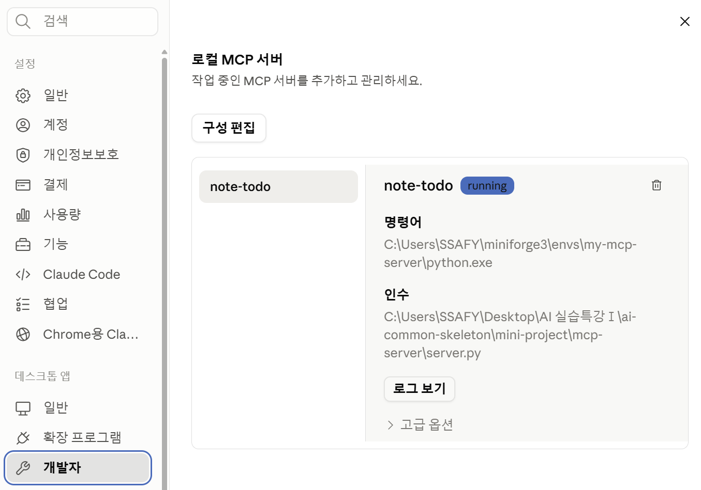
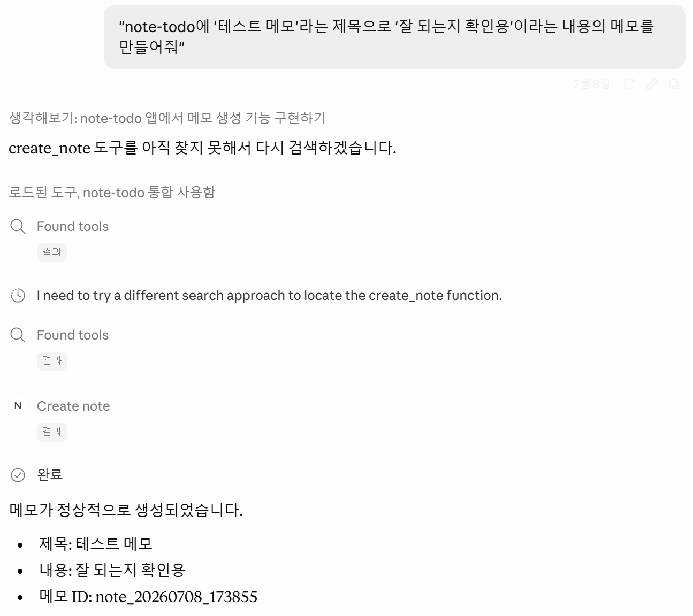
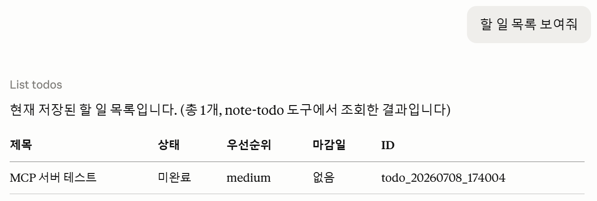
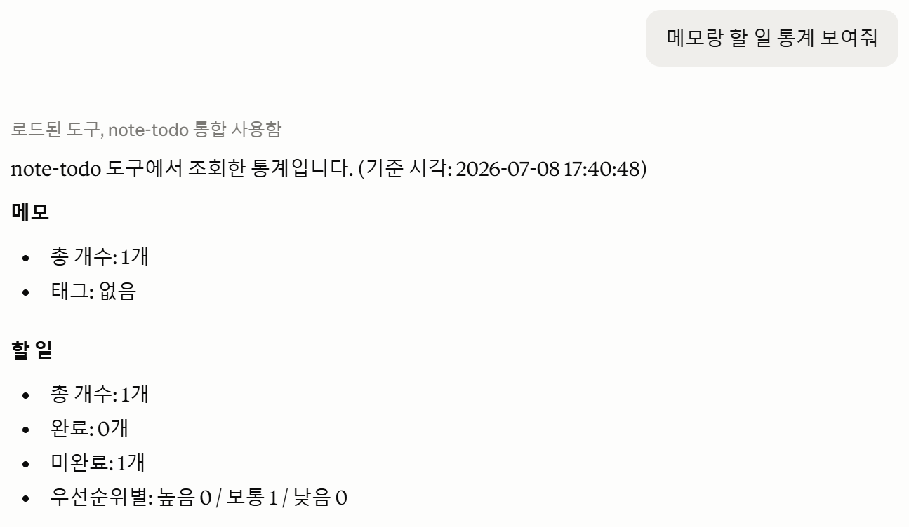
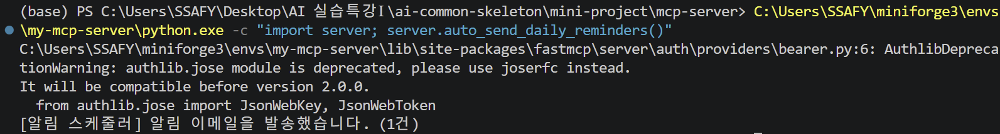
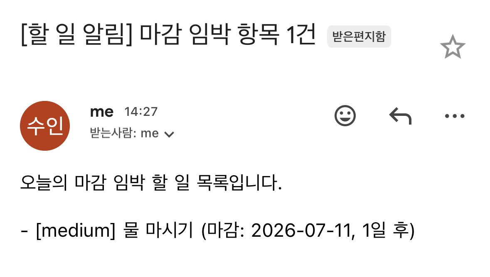

# MCP 서버 만들기 실습 — 개인 메모 및 할 일 관리 MCP

- **날짜**: 2026-07-13
- **주제**: SSAFY AI 실습 특강 미니 프로젝트 — Python + FastMCP로 개인 메모/할 일 관리 MCP 서버를 직접 만들어 본 실습 정리

<br> 

## 0. 오늘 한 줄 요약

오픈소스 MCP 서버를 가져다 쓰는 게 아니라 **Python + FastMCP로 직접 서버를 만들어보는** 실습. 기본 메모/할 일 CRUD에 **① 반복 할 일 생성**, **② 이메일 마감 알림** 두 기능을 확장해서 붙였다.


## 1. MCP(Model Context Protocol)란?

AI 모델(LLM)과 외부 데이터·도구를 연결하는 **표준 규격**. LLM은 원래 학습된 지식 안에 갇혀 있어서 내 컴퓨터 파일이나 외부 API에 직접 접근할 수 없는데, MCP가 이 연결 방식을 하나로 통일해준다. 흔히 "AI를 위한 USB-C 포트"에 비유된다.


## 2. 아키텍처: Host - Client - Server

| 구성요소 | 역할 |
|---|---|
| **Host** | 사용자가 마주하는 AI 앱. 이번 실습에서는 **Claude Desktop** |
| **Client** | 호스트 안에서 서버 하나와 1:1로 연결되는 담당자 (서버 1개 : 클라이언트 1개 → 보안 경계로 격리) |
| **Server** | 실제 도구·데이터를 제공하는 프로그램. 이번에 직접 만든 부분 |

- 통신 메시지 형식: **JSON-RPC 2.0**
- 통신 통로(transport): 로컬 서버는 **stdio**, 원격 서버는 **HTTP**
- 서버가 제공하는 3가지 "프리미티브": **Tools**(AI가 호출·실행하는 함수), **Resources**(읽기 전용 데이터), **Prompts**(재사용 템플릿) — 이번 실습은 Tools·Resources 위주


## 3. 참고: 오픈소스 MCP 서버 모음

**Awesome MCP Servers**: https://github.com/punkpeye/awesome-mcp-servers — 이미 만들어진 서버들을 모아둔 큐레이션 저장소. 🏠(로컬 서버) / ☁️(클라우드 서버) 아이콘으로 성격을 구분한다. 이번에 만든 메모·할 일 서버는 로컬 JSON 파일과 대화하므로 🏠에 가깝다.


## 4. 개발 환경 & 서버 구조

```bash
conda create -n my-mcp-server python=3.10
conda activate my-mcp-server
pip install -r requirements.txt
```

가상환경을 먼저 만드는 이유는 프로젝트 패키지를 시스템 전체와 섞이지 않게 **격리**하기 위함. FastMCP는 **Python 3.10 이상**을 요구한다.

**FastMCP**(<https://gofastmcp.com>, 실습에는 2.8.1 사용)는 Python 기반 MCP 구현 프레임워크로, "MCP의 FastAPI"에 비유된다. `@mcp.tool()` 데코레이터만 붙이면 함수명 → 도구 이름, 타입 힌트 → 입력 스키마, Docstring → 도구 설명으로 자동 변환된다.

```python
mcp = FastMCP("개인 메모 & 할 일 관리")

def load_todos() -> Dict[str, dict]:
    if TODOS_FILE.exists():
        with open(TODOS_FILE, 'r', encoding='utf-8') as f:
            return json.load(f)
    return {}

@mcp.tool()
def create_todo(title: str, priority: str = "medium") -> str:
    """새로운 할 일을 생성한다."""
    todos = load_todos()
    # ... 새 할 일 추가 ...
    save_todos(todos)
    return "할 일이 생성되었습니다!"

if __name__ == "__main__":
    mcp.run()
```

데이터는 별도 DB 없이 `data/notes.json`, `data/todos.json`(+이메일 설정용 `data/email_config.json`) 파일로 저장하고, 모든 도구는 `load_*`/`save_*` 함수로만 데이터에 접근한다. 핵심 구조는 "파일 읽기 → 딕셔너리로 가공 → 다시 파일에 쓰기"라는 단순 CRUD 위에 MCP 데코레이터 껍데기만 얹은 형태다.

**구현된 주요 도구**:
- 메모: `create_note`, `list_notes`, `search_notes`, `update_note`, `delete_note` / 리소스 `notes://all`
- 할 일: `create_todo`, `list_todos`, `complete_todo`, `update_todo`, `delete_todo` / 리소스 `todos://pending`
- 통계: `get_statistics` (완료율, 우선순위별 분포, 태그 사용 빈도 등)


## 5. 프롬프트 하나가 처리되는 9단계

| 순서 | 단계 | 예시 |
|---|---|---|
| 1 | 사용자 프롬프트 | "물 마시기 할 일 완료해줘" |
| 2 | 프롬프트 분석 | "완료", "물 마시기" 키워드 인식 |
| 3 | 도구 목록 확인 | 등록된 `@mcp.tool()` 후보 검토 |
| 4 | 적절한 도구 선택 | 함수명·Docstring 기준으로 `complete_todo` 선택 |
| 5 | 매개변수 추출/생성 | `complete_todo(todo_id="3")` |
| 6 | MCP 서버 호출 요청 | JSON-RPC 메시지 전송 |
| 7 | 서버 함수 실행 | `todos.json` 읽고 수정 |
| 8 | 실행 결과 반환 | `{"status": "completed", ...}` |
| 9 | 자연어 응답 | "'물 마시기' 할 일을 완료 처리했어요!" |

→ 3~4단계가 정확하려면 **함수명, 매개변수 타입, Docstring**이 명확해야 한다.


## 6. Claude Desktop 연결 & 실행 확인

`claude_desktop_config.json`의 `mcpServers`에 python 경로, `server.py` 경로, 가상환경 경로를 등록한다.

```json
{
  "mcpServers": {
    "note-todo": {
      "command": "C:/Users/ssafy/miniforge3/envs/my-mcp-server/python.exe",
      "args": ["C:/Users/ssafy/Documents/workspace/ai-edu/mcp-server/server.py"],
      "cwd": "C:/Users/ssafy/Documents/workspace/ai-edu/mcp-server",
      "env": {
        "VIRTUAL_ENV": "C:/Users/ssafy/miniforge3/envs/my-mcp-server",
        "PATH": "C:/Users/ssafy/miniforge3/envs/my-mcp-server;C:/Users/ssafy/miniforge3/envs/my-mcp-server/Scripts;C:/Users/ssafy/miniforge3/envs/my-mcp-server/Library/bin"
      }
    }
  }
}
```

설정 > 개발자 메뉴에서 서버 상태가 `running`으로 뜨면 연결 성공이다.



자연어 요청이 실제 도구 호출로 이어지는지도 확인했다.

- `"note-todo에 '테스트 메모'라는 제목으로 '잘 되는지 확인용'이라는 내용의 메모를 만들어줘"` → `create_note` 호출

  

- `"할 일 목록 보여줘"` → `list_todos` 호출, 우선순위 기본값(`medium`)까지 정상 반영

  

- `"메모랑 할 일 통계 보여줘"` → `get_statistics` 호출로 총 개수·완료율·우선순위 분포 확인

  


## 7. 확장 기능 ①: 반복 할 일 생성

**설계 고민**: "언제, 누가 다음 회차를 만들 것인가"

- A안(채택): 할 일을 **완료하는 시점**에 다음 회차를 자동 생성 — 기존 `complete_todo` 흐름 안에서 자연스럽게 처리 가능
- B안: 별도 스케줄러가 매일 날짜를 확인 후 미리 생성 — 이메일 스케줄러(8절)와 얽혀 복잡도 증가

**구현**: `repeat_type`(`none`/`daily`/`weekly`/`monthly`) 필드 추가, `create_recurring_todo(title, frequency)`로 첫 회차 생성, `complete_todo` 완료 시 다음 마감일 계산해 신규 생성.

**날짜 계산**: `daily`/`weekly`는 `timedelta`로 간단히 처리되지만, `monthly`는 한 달이 28~31일로 들쭉날쭉해서 `timedelta`로 표현 불가. **`python-dateutil`의 `relativedelta(months=1)`**을 쓰면 "며칠 뒤"가 아니라 "달력상 다음 달 같은 날짜"를 계산해줘서 월말 편차 문제가 해결된다.

```python
def _calculate_next_due_date(due_date, frequency):
    base = datetime.strptime(due_date, "%Y-%m-%d") if due_date else datetime.now()
    if frequency == "daily":
        next_date = base + timedelta(days=1)
    elif frequency == "weekly":
        next_date = base + timedelta(weeks=1)
    elif frequency == "monthly":
        next_date = base + relativedelta(months=1)
    return next_date.strftime("%Y-%m-%d")
```

**그 외 배운 습관**
1. **가드 클로즈(guard clause)**: 잘못된 입력을 함수 초반에 걸러내는 패턴 → 정상 로직의 들여쓰기가 줄어들어 가독성이 좋아짐.
2. **`dict.get()`으로 기본값 지정**: 기존 데이터엔 `repeat_type` 키가 없는 것도 있어서 직접 접근 시 `KeyError` 발생 → `todo.get('repeat_type', 'none')` 습관 필요.


## 8. 확장 기능 ②: 이메일 마감 알림

참고: [schedule 라이브러리](https://schedule.readthedocs.io/en/stable/), [Python email 예제](https://docs.python.org/ko/3.13/library/email.examples.html)

`setup_email_config`로 SMTP 발신 정보를 `data/email_config.json`에 저장하고, `auto_send_daily_reminders`가 오늘·내일 마감인 미완료 할 일을 모아 `smtplib`로 메일을 보낸다. 세 가지 고비가 있었다.

### 8-1. SMTP/TLS, 포트 587 vs 465

SMTP는 이메일을 **보낼 때** 쓰는 프로토콜인데 원래 평문 통신이라, **TLS**로 암호화를 건다.

| | 465번 포트 | 587번 포트 |
|---|---|---|
| 방식 | 암묵적 TLS | 명시적 TLS(STARTTLS) |
| smtplib | `SMTP_SSL(server, 465)` | `SMTP(server, 587)` + `.starttls()` |

Gmail 기본값인 **587 + `starttls()`** 조합으로 구현했다. `starttls()` 이후의 로그인·발송 구간 전체가 암호화 대상이다.

### 8-2. Gmail 앱 비밀번호 & 비밀번호 노출 문제

일반 로그인 비밀번호로는 SMTP 인증이 안 되어, 2단계 인증 후 [앱 비밀번호](https://myaccount.google.com/apppasswords)(16자리 전용 키, 개별 무효화 가능)를 발급받아야 했다. 실습 후 무효화 처리함.

`setup_email_config`는 `@mcp.tool()`로 등록돼 있어 원래는 대화창에서 자연어로 호출 가능하지만, 이 경로로 호출하면 비밀번호가 모델이 함수 인자를 만드는 과정에서 **대화 컨텍스트에 남는** 문제가 있었다. LLM tool-calling 구조상 이 경로로는 값이 컨텍스트에 남는 걸 막을 방법이 없어서, 대신 `data/email_config.json` 파일을 직접 열어 값을 채워 넣었다(이 파일은 `.gitignore`에 등록).

### 8-3. 실행 검증

`auto_send_daily_reminders`는 `@mcp.tool()`이 아니라 Claude에서 직접 호출할 수 없어서, 터미널에서 직접 함수를 호출해 즉시 검증했다.

```bash
python -c "import server; server.auto_send_daily_reminders()"
```



반복 할 일("물 마시기", 마감 임박)이 조건에 걸려 실제로 이메일이 발송·수신되는 것까지 확인했다.



### 8-4. "매일 09:00 자동 발송"의 구현과 한계

1. **schedule은 알람이 아니라 메모지**: `schedule.every().day.at("09:00").do(...)`는 등록만 할 뿐 스스로 시계를 보지 않는다 → `schedule.run_pending()`을 주기적으로 호출해줘야 한다.
2. 이 `while True` 반복문을 메인 흐름에서 그대로 돌리면 `mcp.run()`(Claude 요청 대기)이 실행될 기회가 사라지므로 **별도 스레드**로 분리했다.
3. `daemon=True`를 주지 않으면 메인 프로그램이 끝나도 스케줄러 스레드가 혼자 계속 도는 좀비 상태가 될 수 있어, `daemon=True`로 메인 종료 시 함께 종료되게 했다.

```python
def _run_scheduler_loop():
    schedule.every().day.at("09:00").do(auto_send_daily_reminders)
    while True:
        schedule.run_pending()
        time.sleep(60)

if __name__ == "__main__":
    scheduler_thread = threading.Thread(target=_run_scheduler_loop, daemon=True)
    scheduler_thread.start()
    mcp.run()
```

**근본적 한계**: MCP 서버(`server.py`)는 컴퓨터가 켜져 있다고 항상 도는 게 아니라 **Claude Desktop이 켜져 있을 때만 같이 살아나는 프로그램**이다. 즉 Claude Desktop을 꺼두면 스케줄러도 같이 꺼져서 그날 알림이 안 간다. "무조건 매일" 보내려면 서버 내부 스케줄러가 아니라 **Windows 작업 스케줄러 같은 OS 레벨 스케줄러**에 등록해야 하는데, 이번 실습은 여기까지는 하지 않고 in-process 스케줄러로 마무리했다.


## 9. 핵심 키워드 정리

| 키워드 | 한 줄 설명 |
|---|---|
| MCP | AI와 외부 도구·데이터를 연결하는 표준 규격 |
| Host / Client / Server | MCP의 3주체 구조 (1 서버 : 1 클라이언트) |
| JSON-RPC 2.0 | MCP 메시지 교환 형식 |
| FastMCP | Python 기반 MCP 구현 프레임워크 |
| relativedelta | "달력상 다음 달 같은 날짜"를 계산해주는 dateutil 기능 |
| 가드 클로즈 | 잘못된 입력을 함수 초반에 걸러내는 코드 패턴 |
| STARTTLS(587) vs 암묵적 TLS(465) | 이메일 발송 시 암호화를 언제 거는지의 차이 |
| 앱 비밀번호 | Gmail SMTP 인증용 16자리 전용 키 (2단계 인증 필요) |
| daemon 스레드 | 메인 프로그램 종료 시 함께 종료되는 스레드 |


## 10. 느낀 점

직접 서버를 만들어보니 **날짜 계산, 비밀번호 노출 방지, 스케줄링의 근본적 한계**처럼 오픈소스를 가져다 쓸 때는 몰랐을 문제들을 겪었다. 이번엔 in-process 스케줄러로 마무리했지만, "Claude Desktop이 꺼져 있어도 항상 동작"하게 하려면 OS 레벨 스케줄러 연동이 다음 과제로 남는다.
