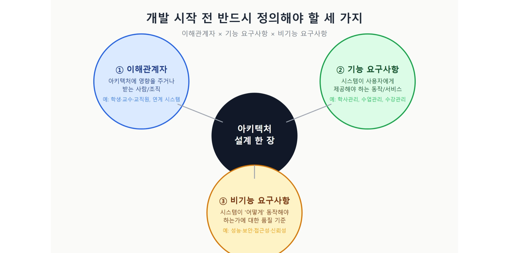
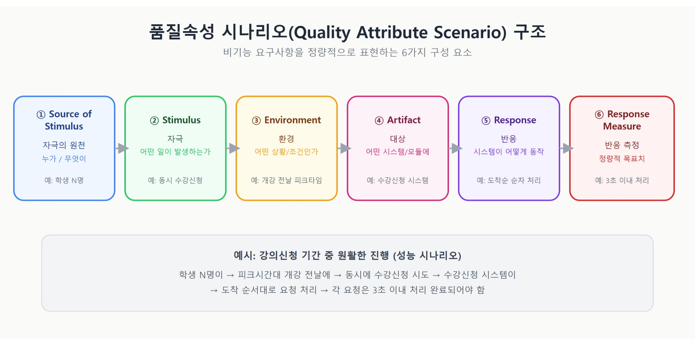
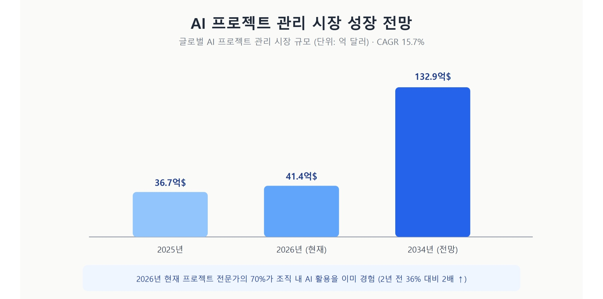
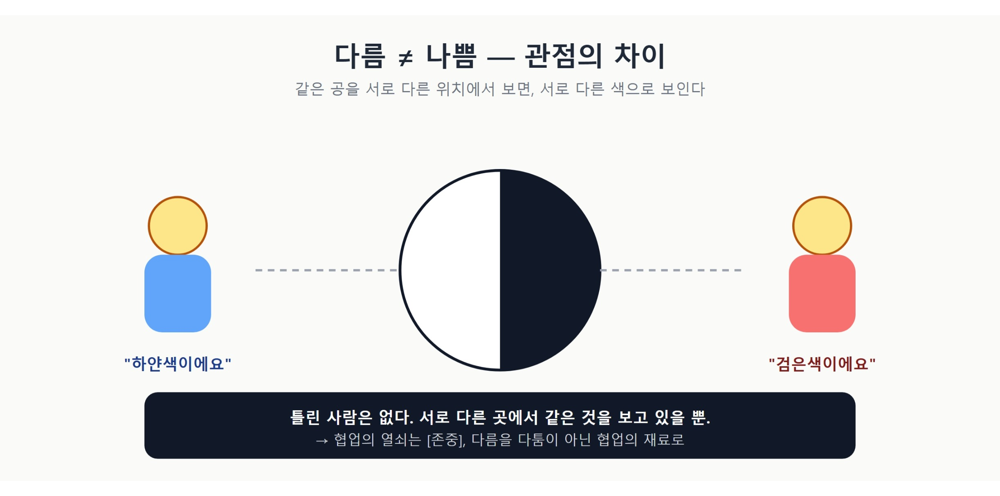

# 개발 설계 & AI 시대 프로젝트 관리 — SSAFY 라이브 특강 정리

- **날짜**: 2026-07-14
- **주제**: SSAFY 라이브 특강 두 편 정리 — ① 개발 시작 전, 반드시 그려야 할 한 장이 있다면? (아키텍처 설계) / ② AI 시대의 프로젝트 관리 (단기 프로젝트 관리 방안)

 

## 0. 오늘 한 줄 요약

두 특강 모두 결국 하나의 원칙으로 수렴한다. **"문제가 터지기 전에, 미리 합의해두는 것이 가장 저렴한 리스크 관리다."** 아키텍처에서는 "설계 전 요구사항 합의"였고, 프로젝트 관리에서는 "갈등 전 규칙 합의"였다.

 

## 1. 개발 시작 전 정의해야 할 3요소 — 이해관계자 / 기능 / 비기능 요구사항

성공적인 시스템 개발을 위해서는 아키텍처 설계 전에 아래 세 가지를 명확히 정의해야 한다.

| 요소 | 정의 | 예시 (학사 시스템 기준) |
|---|---|---|
| **이해관계자(Stakeholders)** | 아키텍처에 영향을 주거나 받는 모든 사람/조직 | 학생, 교수, 교직원, 인사관리 시스템·학사관리 시스템 등 연계 시스템 |
| **기능 요구사항(Functional)** | 시스템이 사용자에게 제공해야 하는 구체적 동작·서비스 | 학사 관리, 수업 관리, 수강 관리, 사용자 관리 |
| **비기능 요구사항(Non-Functional)** | 시스템이 "어떻게" 동작해야 하는가에 대한 품질 특성 | 성능(원활한 수강신청), 접근성(어디서든 접속), 보안(권한 부여), 신뢰성(데이터 손실 최소화) |

기능 요구사항은 "무엇을(what)" 만들지에 대한 답이고, 비기능 요구사항은 "얼마나 잘(how well)" 만들지에 대한 답이라는 구분이 핵심. 개발 초반엔 기능 목록에만 집중하기 쉬운데, 실제 서비스 품질을 가르는 건 오히려 비기능 요구사항이라는 설명이 인상적이었다.

 

## 2. 품질속성 시나리오(Quality Attribute Scenario)

비기능 요구사항은 "성능이 좋아야 한다"처럼 추상적으로 서술되기 쉬운데, 이를 설계·평가에 실제로 쓸 수 있게 정량화한 형식이 품질속성 시나리오다.

**시나리오 6대 구성 요소**

| # | 요소 | 의미 |
|---|---|---|
| 1 | Source of Stimulus | 자극의 원천 (누가/무엇이) |
| 2 | Stimulus | 자극 (어떤 일이 발생하는가) |
| 3 | Environment | 환경 (어떤 상황/조건에서) |
| 4 | Artifact | 대상 (어떤 시스템/모듈에) |
| 5 | Response | 반응 (시스템이 어떻게 동작하는가) |
| 6 | Response Measure | 반응 측정 (동작의 정량적 목표치) |

**실전 시나리오 예시 3가지**

| 시나리오 | Source | Stimulus | Environment | Artifact | Response | Response Measure |
|---|---|---|---|---|---|---|
| ① 성능 | 학생 N명 | 동시 수강신청 시도 | 학기 시작 전날 피크 시간대 | 수강신청 시스템 | 도착 순서대로 처리 | 3초 이내 처리 완료 |
| ② 보안 | 학생/외부 사용자 | 비정상 로그인 시도 | 외부 네트워크 포함 접속 환경 | 학사관리 시스템 | 비정상 접근 차단 + 알림 로그 생성 | 1초 이내 즉시 차단 |
| ③ 가용성 | 내부 시스템 모듈 | 서비스 인스턴스 장애 | 고가용성(HA) 클러스터 환경 | 서비스 디스커버리 매커니즘 | 인스턴스 트래픽 대상 즉시 제외 | Failover 5초 이내 완료 |

 

## 3. 단기 프로젝트 관리의 3축 — 방법 / 권한 / 규칙

| 축 | 핵심 내용 |
|---|---|
| **방법** | 방법을 모르는 팀원들이 배움을 통해 습득·적용 |
| **권한** | PM 같은 수직적 권한 대신 **협의된 방법(규칙)** 에 권한을 부여 |
| **규칙** | 문제가 발생하기 **전에** 미리 대응 방안을 정해두는 것 |

- 기술 리더는 팀원 투표로 선정, 기준은 **기술력 50% + 소통역량 50%**.
- 각 팀에 [팀장]+[기술 리더]가 기본 권한을 갖되, 실제 갈등 관리는 전체 팀원이 함께 한다.
- [권한]은 [규칙]으로 정의되지 않는 예외 상황의 해결 방법. 단기 프로젝트에서는 팀장·기술리더가 억지로 권한을 행사하면 오히려 갈등이 심화될 수 있어, "팀장에게 권한을 주자" / "팀장+기술리더 협의" / "다수결" 같은 규칙을 **갈등 전에** 미리 합의해두는 방식을 제안했다.

 

## 4. 방법 4단계 — 업무 분해 → 역할 분배&일정 → 보고 → 일정/변화 관리

| 단계 | 핵심 |
|---|---|
| **업무 분해** | 분석→설계→구현→테스트→전개 단계별 3Depth 분해. 생성형 AI에게 가이드는 받되, **AI 답을 그대로 쓰지 않고 필요한 것만 체크**하는 방식으로 활용 |
| **역할 분배&일정** | 팀장+기술리더 1차 분배 → 팀원 전체 사전 리뷰 → 확정 → 전체 이메일 회신으로 재확인. 충돌 시 최종 결정권은 [팀장+기술리더] |
| **보고** | "팀장이 파악해야 하는 것"이 아니라 **"팀원이 공유하는 것"**. 항목: 일정지연 여부 / 진행 이슈 / 변경 사항 / 지원 요청 |
| **일정/변화 관리** | 데일리 스크럼 기반, 이상 없으면 빠르게 종료. 팀장도 자기 [품질]을 스스로 관리 |

 

## 5. 자주 발생하는 사례별 대응 방안

| 문제 유형 | 대응 방안 |
|---|---|
| **의욕의 차이** | 최소치(의무)-최대치(자율)로 업무 분해, 일정은 최소치 기준. 최대치 수행자에게 인센티브 |
| **역량의 차이** | 역량 높은 사람은 [배려], 낮은 사람은 [존중]을 기본으로. 상호평가 시 기여도 고려 |
| **책임의 부재(이탈)** | 발생 자체를 막기보단 "빨리 공유"하는 문화 + 이탈 시 역할 재배분 규칙(1/N 등) 사전 합의 |
| **관계의 문제** | 당사자 간 직접 표현 자제, 감지한 팀원이 [코치]에게 즉시 알리고 중재 요청 |
| **표현의 문제** | 사전에 [중재자] 지정, 반드시 1:1로만 피드백. "누가 그랬다"가 아니라 "이런 표현은 조심하자"는 내용만 전달 |

 

## 6. 가장 중요한 규칙 — 결국은 '존중'

> 아무리 좋은 방법과 규칙이 있어도 서로를 존중하지 않으면 의미가 없다.

강의에서는 흑백 공 실험 영상으로 이 메시지를 전달했다. 같은 공을 서로 다른 자리에서 보면 한쪽은 흰색, 반대쪽은 검은색으로 보인다. 자리를 바꿔봐야 비로소 상대가 왜 그렇게 말했는지 이해가 된다는 내용이다.

실무 현장에서도 [다름]이 [나쁨]으로 잘못 인식되는 경우가 많다. 프로젝트 중 발생하는 대부분의 갈등은 누군가가 나빠서가 아니라, **서로가 다름에 익숙하지 않아서** 생긴다는 결론이었다.

 

## 7. 더 찾아본 내용 — 흑백 공 영상 출처 & 2026년 AI-PM 트렌드

**흑백 공 영상 출처**: 검색해보니 한 대학 강의실에서 있었던 실제 수업 장면으로, 교수가 같은 공을 다른 위치에서 보여주고 색깔을 물어본 뒤 자리를 바꿔보게 하는 "관점(perspective)"에 관한 유명 영상이다. 비슷한 결의 유명 심리 실험으로 **투명 고릴라 실험(Simons & Chabris)** 도 있다 — 흰 옷 팀의 패스 횟수에 집중하다 화면 속 고릴라를 못 알아채는 실험으로, "우리가 보는 게 전부가 아니다"라는 메시지가 겹친다.

오늘 배운 "팀장+기술리더가 다 책임지지 말고 역할을 나누고 각자 능동적으로 공유하라"는 원칙이, AI 에이전트 활용이 늘어난 환경에서도 그대로 통하는 원칙이라는 생각이 들었다.

참고: [YouTube Shorts — 교수의 관점 수업 영상](https://www.youtube.com/shorts/QZPn90WQPj0) · [Human Perception and the Invisible Gorilla | TIME](https://time.com/archive/6934526/human-perception-and-the-invisible-gorilla/) · [AI 프로젝트 관리 2026년 5월](https://www.jenova.ai/ko/resources/ai-project-management-202605) · [2026년 1분기 AI Hot Issue 5 — 에이전트의 혁명](https://www.issueon.co.kr/news/articleView.html?idxno=12816) · [포브스코리아 〈2026 AI 트렌드〉 TOP 7](https://www.forbeskorea.co.kr/news/articleView.html?idxno=401186)

 

## 8. 핵심 키워드 정리

| 키워드 | 한 줄 설명 |
|---|---|
| 이해관계자 / 기능·비기능 요구사항 | 아키텍처 설계 전 정의해야 할 3요소 |
| 품질속성 시나리오(QAS) | 비기능 요구사항을 6요소로 정량화한 명세 형식 |
| ATAM | 품질 속성 기반 아키텍처 평가 방법론, 유틸리티 트리로 시나리오 구조화 |
| 민감점 / 트레이드오프 지점 | 아키텍처 결정이 품질에 큰 영향을 주는 지점 / 한 속성 개선이 다른 속성을 해치는 지점 |
| 방법·권한·규칙 | 단기 프로젝트 관리의 3축 |
| 최소치-최대치 업무 분해 | 의욕 차이 대응: 최소치는 의무, 최대치는 자율+인센티브 |
| 1:1 중재 원칙 | 표현 문제 발생 시 다수 앞이 아닌 1:1로만 피드백 전달 |
| 존중 | 모든 방법·규칙보다 우선하는 협업의 핵심 원칙 |
| 멀티 에이전트 시스템(MAS) | 역할을 나눠 협업하는 여러 AI 에이전트 구조, 2026년 PM 분야 핵심 트렌드 |

 

## 9. 느낀 점

두 강의를 하나로 묶어보면, 개발이든 협업이든 **"시작 전에 그려야 할 한 장"** 은 결국 *"우리가 무엇을, 어떤 기준으로, 누구와 어떻게 하기로 미리 합의했는가"* 를 담은 문서라는 생각이 든다.

아키텍처 쪽에서는 비기능 요구사항을 숫자로 명세하지 않으면 나중에 "이 정도면 빠른 거 아니야?" 같은 소모적 논쟁이 생긴다는 게 뼈아프게 다가왔고, 품질속성 시나리오의 6요소는 이후 프로젝트 설계 문서에 그대로 써먹을 수 있는 범용 템플릿이라 실용적이었다.

프로젝트 관리 쪽에서는 관리의 본질이 "감시"가 아니라 "공유 설계"라는 재정의가 가장 크게 남는다. 권한도 결국 "사람"이 아니라 "사전에 합의된 규칙"에서 나와야 갈등을 줄일 수 있다는 논리, 그리고 갈등 중재는 절대 다수 앞이 아니라 1:1로만 해야 한다는 디테일이 실제로 적용해볼 만하다고 느꼈다. 강의 제목은 "AI 시대의"였지만 내용의 8할은 AI 없이도 통하는 협업의 기본기였고, 오히려 그 점이 더 오래 기억에 남을 것 같다.

다음 프로젝트 킥오프 때 오늘 배운 두 프레임(품질속성 시나리오 / 최소치-최대치 업무분해 + 사전 규칙 합의)을 실제로 적용해봐야겠다.

 