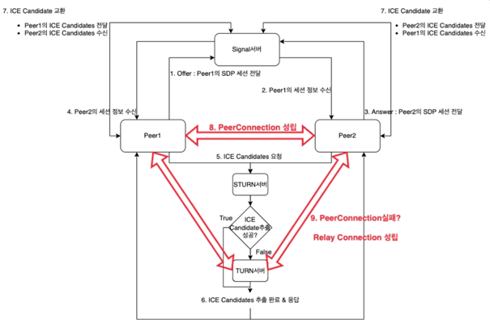
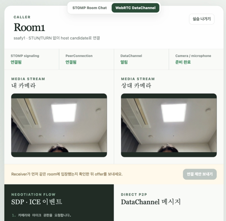
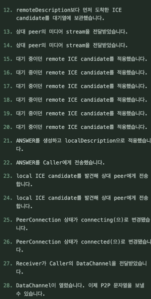

# WebRTC란?

WebRTC는 브라우저 사이에서 영상, 음성, 데이터를 실시간으로 주고받을 수 있도록 지원하는 기술이다.

---

## 1. 용어 정리

### SDP

SDP는 WebRTC 통신 전, 각 Peer가 사용할 **미디어 데이터 교환 방식**을 메타데이터 형태로 표현하는 프로토콜이다.

내부에는 사용할 코덱, 미디어 샘플레이트 등의 정보가 포함된다.

* 코덱: 미디어 데이터를 압축하고 복원하는 방식이다.
* 샘플레이트: 미디어를 1초에 몇 번 측정하여 디지털 데이터로 변환할지를 나타낸다. 값이 높을수록 더 높은 주파수의 소리를 표현할 수 있다.

SDP는 Session Description Protocol의 약자이다.

### NAT

NAT는 공인 IP와 사설 IP를 상호 변환하는 네트워크 기술이다.

### ICE Candidate

ICE Candidate는 Peer 간 연결을 만드는 데 필요한 **접속 후보 주소 정보**이다.

연결에 사용할 IP, 포트, 프로토콜, 후보 유형 등의 정보가 포함된다.

* `host candidate`: 자신의 로컬 IP와 포트이다.
* `server reflexive candidate`: STUN 서버를 통해 확인한 공인 IP와 포트이다.
* `relay candidate`: TURN 서버가 할당한 중계 주소이다.

ICE는 Interactive Connectivity Establishment의 약자이다.

### STUN 서버

STUN 서버는 NAT 외부에서 보이는 자신의 공인 IP와 포트를 알려주는 서버이다.

이를 통해 `server reflexive candidate`를 생성할 수 있다.

### TURN 서버

TURN 서버는 Peer 간 직접 연결이 어려운 경우 자신의 서버 주소를 `relay candidate`로 제공하고, 미디어와 데이터를 대신 전달하는 서버이다.

즉, P2P 연결에 실패하면 TURN 서버가 두 통신 주체 사이에서 데이터를 대신 전달하는 릴레이 서버 역할을 한다.

### Signaling 서버

Signaling 서버는 Peer들이 연결되기 전에 **초기 연결 정보를 교환할 수 있도록 중개하는 서버**이다.

주로 다음 정보를 교환한다.

1. SDP를 교환하여 미디어 데이터 교환 방식을 공유한다.
2. STUN 또는 TURN 서버를 통해 수집한 네트워크 주소 정보를 교환한다.

---

## 2. WebRTC가 제공하는 API

* `MediaStream`: 카메라나 마이크에서 가져온 영상·음성 트랙을 묶어 관리하는 객체이다.

    * 카메라 영상: Video Track
    * 마이크 음성: Audio Track
* `RTCPeerConnection`: Peer 간 연결을 생성하고 SDP, ICE, 미디어 송수신 등을 관리하는 핵심 API이다.
* `RTCDataChannel`: Peer 간에 텍스트, 파일 등의 일반 데이터를 주고받는 API이다.

세 API는 모두 브라우저가 제공하는 Web API이며, 프론트엔드에서 사용한다.

---

## 3. 시그널링 과정

SDP Offer와 Answer 교환은 통신 조건을 협상하는 과정이다. ICE Candidate 교환은 실제로 연결할 네트워크 주소를 찾는 과정이다.

두 과정은 순차적으로 완전히 분리되어 진행되는 것이 아니라 서로 겹쳐서 진행된다.

이 과정에서는 WebSocket을 활용하여 Peer 간 연결 정보를 양방향으로 빠르게 주고받을 수 있다.

### 3-1. SDP Offer와 Answer 교환

WebRTC 연결에서 SDP를 교환하는 흐름은 다음과 같다.

1. 한 Peer가 `RTCPeerConnection`을 생성한다.
2. 자신의 미디어 트랙을 등록한다.
3. `createOffer()`로 SDP Offer를 생성한다.
4. Signaling 서버를 통해 상대방에게 전달한다.
5. 상대방은 Offer를 `setRemoteDescription()`으로 설정한다.
6. `createAnswer()`로 SDP Answer를 생성한다.
7. Signaling 서버를 통해 최초 Peer에게 전달한다.
8. 최초 Peer는 Answer를 `setRemoteDescription()`으로 설정한다.

### 3-2. ICE Candidate 교환

ICE Candidate를 교환하는 흐름은 다음과 같다.

1. 각 Peer가 `RTCPeerConnection`을 생성한다.
2. `setLocalDescription()`이 호출되면 브라우저가 ICE Candidate 수집을 시작한다.
3. 로컬 주소, STUN 서버를 통해 확인한 공인 주소, TURN 서버의 릴레이 주소 등이 Candidate로 생성된다.
4. Candidate가 생성될 때마다 `onicecandidate` 이벤트가 발생한다.
5. 생성된 ICE Candidate를 Signaling 서버를 통해 상대방에게 전달한다.
6. 상대방은 전달받은 Candidate를 `addIceCandidate()`로 등록한다.
7. 상대방도 동일한 방식으로 자신의 ICE Candidate를 수집하여 Signaling 서버로 전달한다.
8. 최초 Peer도 전달받은 Candidate를 `addIceCandidate()`로 등록한다.
9. 양쪽 브라우저는 교환된 Candidate 조합을 사용하여 실제 연결 가능 여부를 검사한다.
10. 연결 가능한 후보 중 우선순위가 높은 경로를 선택하여 WebRTC 연결을 완료한다.

---

## 4. 연결 이후 미디어 전송

시그널링이 완료되면 영상과 음성은 더 이상 Signaling 서버를 통해 전달되지 않는다.

* 직접 연결에 성공한 경우: `Peer A ↔ Peer B`
* 직접 연결에 실패한 경우: `Peer A ↔ TURN 서버 ↔ Peer B`

실제 영상과 음성은 RTP 기반으로 전송된다.

* `RTP`: 영상과 음성 데이터를 전달한다.
* `RTCP`: 패킷 손실률, 지연 시간 등의 통신 품질 정보를 전달한다.
* `SRTP`: 미디어 데이터를 암호화하여 전달한다.

---

## 5. 연결 상태 관리

브라우저에서 생성한 `RTCPeerConnection` 객체의 상태값을 통해 WebRTC 연결이 정상적으로 진행되고 있는지 확인할 수 있다.

* `signalingState`: SDP 협상 상태를 나타낸다.
* `iceGatheringState`: ICE Candidate 수집 상태를 나타낸다.
* `iceConnectionState`: ICE 연결 상태를 나타낸다.
* `connectionState`: 전체 Peer 연결 상태를 나타낸다.

이러한 상태값은 장애 처리나 재연결을 구현할 때 중요하다.

---

## 6. 다자간 통신 구조

참가자가 여러 명인 경우에는 미디어를 전달하는 연결 구조를 고려해야 한다.

### Mesh

모든 Peer가 서로 직접 1:1로 연결하는 구조이다.

참가자가 N명일 때 각 클라이언트는 N-1개의 연결과 스트림을 처리해야 하므로, 3~4명 이하의 소규모 그룹에 적합하다.

### SFU

각 Peer가 서버에 미디어를 보내고, 서버가 이를 다른 참가자에게 전달하는 중앙 집중형 구조이다.

확장성이 뛰어나고 비용과 품질의 균형이 우수하여 대부분의 화상회의 및 라이브 스트리밍에 활용된다. LiveKit이나 mediasoup 등의 솔루션을 사용할 수 있다.

### MCU

서버가 여러 영상을 하나로 합성한 뒤, 모든 Peer에게 하나의 스트림으로 전달하는 구조이다.

서버에서 모든 영상을 실시간으로 인코딩하고 합성해야 하므로 많은 CPU와 하드웨어 자원이 필요하다.

---

# 실습

- 이번 실습의 목적은 Spring Boot로 구현한 시그널링 서버를 통해 두 브라우저가 WebRTC 연결에 필요한 정보를 정상적으로 교환할 수 있는지 확인하는 것이었다.
- 로컬에서 브라우저 두 개를 실행하여 테스트했으며, 두 Peer가 미디어를 실시간으로 주고받는 것을 확인했다. 또한 로그를 통해 시그널링 과정을 확인했다.
- WebRTC 연결 과정 학습에 집중하기 위해 Caller와 Receiver를 직접 지정했다.
  - Caller: SDP Offer를 생성하고 전송하는 Peer
  - Receiver: SDP Offer를 받고 SDP Answer를 생성하는 Peer

  
  

