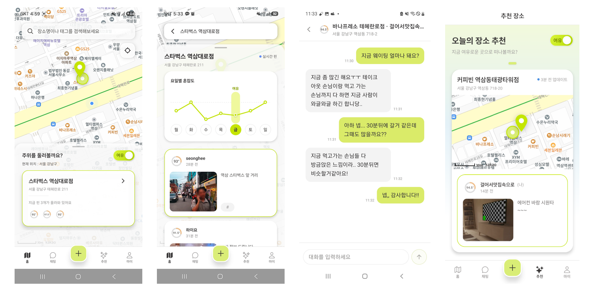
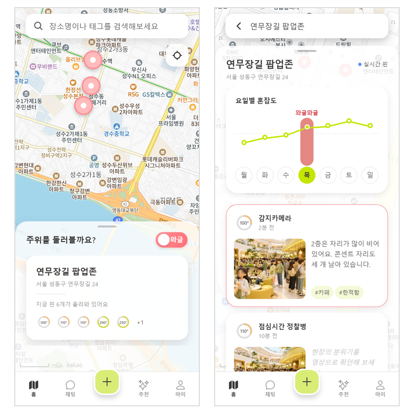
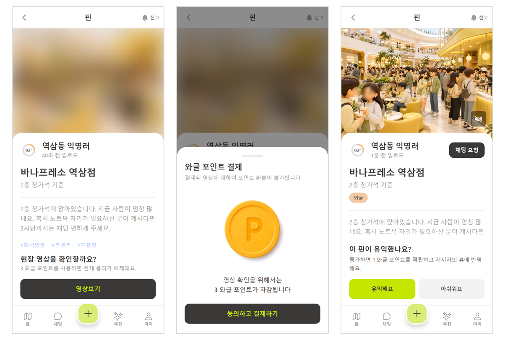
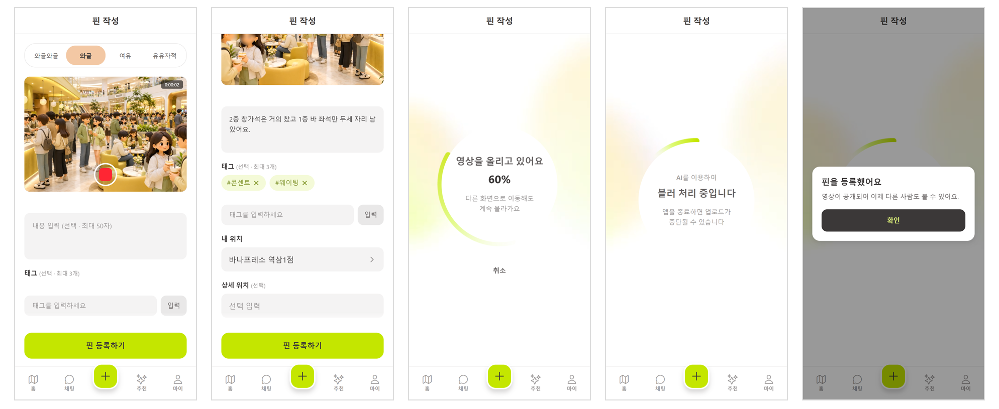
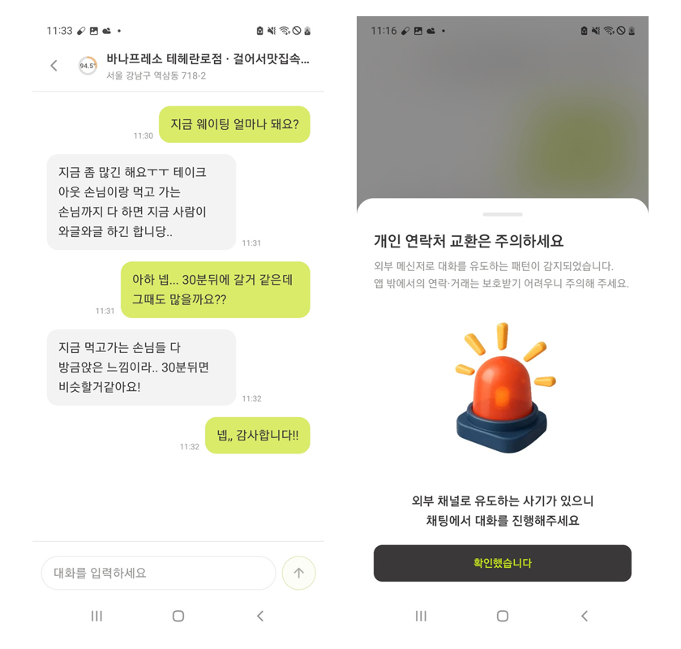
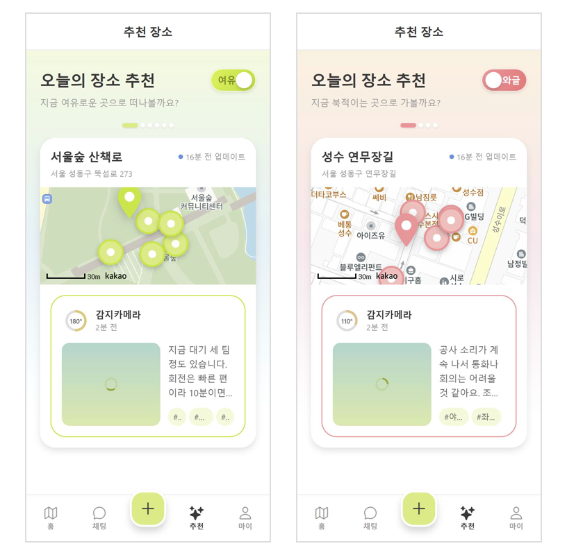
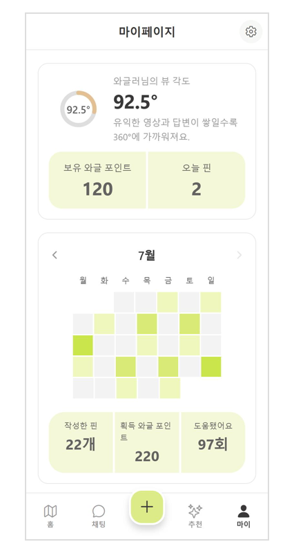
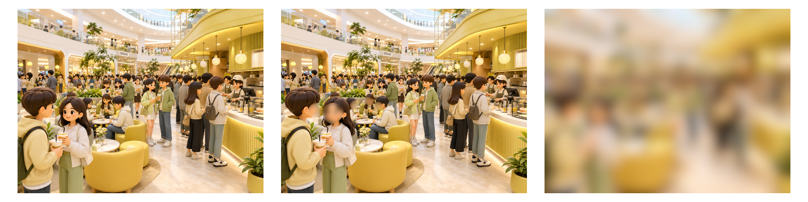
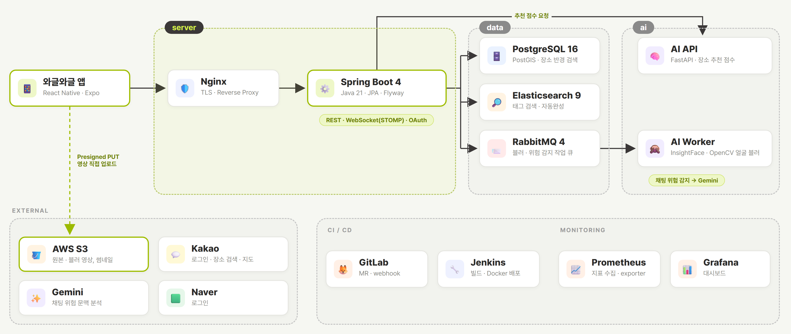

<div align="center">


# 와글와글

**방문하기 전에, 그곳의 지금을 먼저 봐요**

지금 그 장소가 얼마나 붐비는지 **5초짜리 현장 영상**으로 확인하는 안드로이드 앱<br>
올라온 영상은 AI가 행인 얼굴을 가린 뒤 공개되고, 열람은 크레딧으로 합니다.



</div>

<br>

## 0. 담당 파트 — 프론트엔드

> React Native(Expo) 앱의 **영상핀 등록 · 열람 · 채팅 · 추천 · 마이페이지** 화면과, 화면과 서버 사이의 **API 계층**을 맡았습니다.<br>
> React Native · Expo · TypeScript · STOMP

| 기능 | 한 일 |
| :--- | :--- |
| **영상핀 등록** | 5초 촬영, 위치 · 혼잡도 · 태그 입력, 영상을 서버를 거치지 않고 저장소로 바로 올리는 업로드 |
| **업로드 진행 4단계** | 진행 상태를 화면이 아니라 전역 스토어가 들게 해, 다른 화면으로 가도 업로드와 AI 블러 대기가 이어지게 함 |
| **핀 열람 · 결제** | 결제 전 영상 블러(안드로이드 버전별 대응 포함), 크레딧 결제와 중복 결제 방지 키 |
| **실시간 채팅** | STOMP 소켓 계층을 처음부터 만들고, 10초 폴링이던 채팅 목록을 소켓 이벤트로 교체 |
| **추천 · 마이페이지** | 장소 추천 카드와 혼잡도 그래프, 활동 달력 · 크레딧 내역 · 프로필 수정 |
| **화면 이동 안정화** | 버튼을 두 번 눌러도 같은 화면이 두 장 쌓이지 않게, 라우터 한 곳에서 목적지 기준으로 막음 |

자세한 내용은 [3.3 영상핀 등록](#33-영상핀-등록--기다리는-동안에도-앱을-쓸-수-있게)과 [4. 핵심 기술](#4-핵심-기술--차별점)에 있습니다.

<br>

## 1. 프로젝트 소개

**와글와글**은 사람들이 그 자리에서 찍어 올린 **5초짜리 현장 영상**으로 장소의 지금 혼잡도를 보여 주는 안드로이드 앱입니다.

사용자는 지도에서 장소를 고르고, 그 장소에 **방금 올라온 영상핀**과 요일별 혼잡도를 확인합니다.<br>
영상을 올린 사람은 **와글 포인트**를 받고, 보는 사람은 포인트로 영상을 열어 봅니다. 영상 속 행인의 얼굴은 **AI가 자동으로 가린 뒤** 공개되고, 궁금한 점은 올린 사람에게 **1:1 익명 채팅**으로 바로 물어볼 수 있습니다.

<br>

### 홍보 영상

https://github.com/user-attachments/assets/9b7ed09a-7d70-4a34-9384-f1157f87ad13

<br>

---

## 2. 기획 배경

### 문제

> 주말에 핫플에 갔는데 사람이 너무 많아서 **그냥 돌아간 적**, 있으신가요?

- **정보의 시차가 있습니다.**<br>
  지도와 리뷰는 과거의 기록이라, 지금 그곳이 얼마나 붐비는지는 알 수 없습니다.
- **정보가 흩어져 있습니다.**<br>
  숏츠, 인스타그램 태그, 제보 앱을 하나씩 찾아보거나 가게에 전화로 물어봐야 합니다.
- **제보할 이유가 없습니다.**<br>
  현장에 있는 사람이 지금 상황을 굳이 올려 줄 보상이 없습니다.

### 와글와글의 접근

> **숫자 대신 영상으로, 선의 대신 보상으로** 현장을 공유하게 합니다.

```text
영상핀 등록 → AI 얼굴 블러 → 포인트로 열람 → 올린 사람에게 포인트 보상 → 다시 영상핀 등록
```

| 목표 | 방법 |
| :--- | :--- |
| **지금의 현장** | 영상은 그 자리에서 찍어야만 올릴 수 있고, 촬영 위치가 장소 반경 안이어야 등록 |
| **한곳에 모으기** | 장소마다 영상핀과 요일별 혼잡도를 지도 위에 모아 보여 줌 |
| **제보의 이유** | 영상을 올리면 포인트를 받고, 열람 · 채팅에 포인트를 씀 |
| **초상권 보호** | 행인 얼굴만 AI로 가리고 배경은 선명하게 공개 |
| **바로 물어보기** | 영상을 올린 사람에게 1:1 익명 채팅으로 질문 |
| **신뢰도** | 평가와 신고가 뷰 각도(신뢰도)에 쌓여, 낮으면 이용 제한 |

### 타깃 사용자

- 카페 · 맛집 · 팝업에 가기 전에 **지금 붐비는지 미리 확인하고 싶은** 사용자
- 이미 현장에 있어서 **지금 상황을 공유하고 보상을 받고 싶은** 사용자
- 숫자보다 **눈으로 직접 보고** 판단하고 싶은 사용자

<br>

---

## 3. 주요 기능

> 모든 화면은 백엔드 없이 앱을 목업 데이터 모드로 실행해 캡처했습니다. 영상과 썸네일 자리에는 임시 이미지를 넣었습니다.

### 3.1 실시간 영상핀

- 지도 위 장소에 **지금 올라와 있는 영상핀 수**가 보입니다.
- 장소를 열면 요일별 혼잡도 그래프와, 최근 올라온 영상핀 목록이 나옵니다.

<p align="center">
  
</p>

<br>

### 3.2 크레딧으로 열람

- 영상은 결제 전에는 흐리게 보이고, 크레딧을 내면 열립니다.
- 영상은 그 자리에서 찍어야만 올릴 수 있고, 촬영 위치가 장소 반경 안이어야 합니다. 다른 사용자의 신고가 쌓이면 신뢰도가 내려갑니다.

<p align="center">
  
</p>

<br>

### 3.3 영상핀 등록 — 기다리는 동안에도 앱을 쓸 수 있게

- 5초 영상을 찍고 혼잡도 · 내용 · 태그를 붙여 등록합니다.
- '처리 중' 한 마디 대신 **준비 → 업로드 → 얼굴 가리는 중 → 게시 완료** 4단계로 보여 주고, 진행 중에 다른 화면으로 가도 업로드가 이어집니다.

<p align="center">
  
</p>

<br>

### 3.4 1:1 익명 채팅 · AI 위험 감지

- 영상을 올린 사람에게 현장 상황을 바로 물어볼 수 있습니다. 욕설은 보내는 순간 가려집니다.
- 선입금 요구나 외부 메신저 유도 같은 위험한 대화가 감지되면 경고를 띄웁니다.

<p align="center">
  
</p>

<br>

### 3.5 AI 장소 추천

- 지금 여유로운 곳, 또는 와글와글한 곳으로 토글해 오늘 가 볼 만한 장소를 추천받습니다.

<p align="center">
  
</p>

<br>

### 3.6 마이페이지

- 내 신뢰도(뷰 각도)와 보유 포인트, 달마다 핀을 올린 날을 달력으로 보여 줍니다.
- 오늘 작성한 핀의 게시 상태, 포인트 적립·사용 내역, 닉네임과 선호 장소 수정 화면으로 이어집니다.

<p align="center">
  
</p>

<br>

---

## 4. 핵심 기술 · 차별점

### 4.1 배경은 선명하게, 얼굴만 흐리게 (AI)

<p align="center">
  
</p>

- 다 흐리면 현장감이 사라지고, 안 흐리면 초상권이 남기 때문에 **얼굴만** 가립니다.
- 한 장면만 얼굴을 놓쳐도 노출되므로, 앞 장면과 지금 장면의 얼굴 위치가 겹치는 정도(**IoU**)로 같은 사람을 이어 추적해 놓친 장면을 메웁니다.
- 얼굴이 뚫린 장면 비율을 **15.7% → 5.3%** 로 줄였습니다.

### 4.2 업로드 진행 상태를 화면 밖으로 (프론트)

- 블러 처리가 정교해질수록 기다리는 시간이 길어졌습니다(약 11초).
- 진행 상태를 화면이 아니라 **전역 스토어**가 들게 해, 화면을 나가도 작업이 끊기지 않게 했습니다.
- 영상은 서버를 거치지 않고 **Presigned URL로 저장소에 바로 올리고**, 서버에는 키만 넘깁니다.

### 4.3 결제 전 영상에 블러가 안 걸리던 문제 (프론트)

- 영상 위에 블러 컴포넌트를 얹었더니 반투명 막만 생기고 영상은 그대로 보였습니다. 안드로이드의 영상 서피스가 뷰 계층 밖의 별도 레이어였기 때문입니다.
- 영상을 다른 UI와 같은 경로로 그리도록 바꾸고(`textureView`) 그 위에 흐림 필터를 걸었습니다.
- 흐림 필터가 동작하지 않는 **안드로이드 11 이하**에서는 덮개로 가리고, 서버는 원본 영상 주소를 아예 주지 않게 해 **이중으로** 막았습니다.

### 4.4 같은 화면이 두 장 쌓이던 문제 (프론트)

- 버튼을 빠르게 두 번 누르면 같은 화면이 두 번 열렸습니다.
- 버튼 수십 개를 고치는 대신 **라우터 한 곳을 감싸고**, 시간이 아니라 **목적지**를 비교해 막았습니다. 천천히 두 번 눌러도 두 장이 되지 않습니다.

### 4.5 안드로이드 15에서 키보드가 입력칸을 가리던 문제 (프론트)

- 같은 앱이 OS 버전에 따라 다른 화면 높이를 받아, 14 이하에서 맞던 계산이 15부터 어긋났습니다.
- OS가 해석해 주는 값 대신 **실제로 잰 값**만으로 겹침을 계산하도록 다시 세웠습니다.

<br>

---

## 5. 기술 스택

### Frontend

| 분류 | 기술 |
| :--- | :--- |
| **Language · Framework** | TypeScript 5.9, React 19.1, React Native 0.81.5, Expo SDK 54 |
| **Routing** | Expo Router 6 |
| **Network · Realtime** | Axios, @stomp/stompjs 7.3 (STOMP over WebSocket) |
| **Media** | expo-camera (5초 촬영), expo-video |
| **Map** | react-native-webview 13.15 + 카카오맵 JavaScript SDK |
| **Build** | EAS Build (Android) |

### Backend

| 분류 | 기술 |
| :--- | :--- |
| **Language · Framework** | Java 21, Spring Boot 4.0.7, Gradle 9.5.1 |
| **Web · Realtime** | Spring Web MVC, Spring WebSocket (STOMP), Bean Validation |
| **Security** | Spring Security, JJWT 0.12.6 |
| **Data Access** | Spring Data JPA, Hibernate Spatial, Flyway, Spring Data Elasticsearch |
| **Messaging · Cache** | Spring AMQP (RabbitMQ), Caffeine |
| **Storage** | AWS SDK S3 (Presigned URL) |
| **Observability** | Spring Boot Actuator, Micrometer Prometheus |

### AI

| 분류 | 기술 |
| :--- | :--- |
| **Language · Framework** | Python 3.12, FastAPI, Uvicorn, Pydantic v2 |
| **Face Blur** | InsightFace (SCRFD), ONNX Runtime, OpenCV, FFmpeg |
| **Messaging** | aio-pika (RabbitMQ Worker) |
| **LLM** | Gemini (google-genai) — 채팅 위험 문맥 분석 |
| **Test · Lint** | pytest, mypy, ruff |

### Database

| 분류 | 기술 |
| :--- | :--- |
| **RDBMS** | PostgreSQL 16 + PostGIS 3.5 |
| **Search** | Elasticsearch 9.2.8 |
| **Message Queue** | RabbitMQ 4 |

### Infra · DevOps

| 분류 | 기술 |
| :--- | :--- |
| **CI/CD** | GitLab, Jenkins |
| **Container** | Docker, Docker Compose |
| **Web Server · TLS** | Nginx |
| **Monitoring** | Prometheus 3.1, Grafana 11.4, node-exporter, cAdvisor, postgres · elasticsearch exporter |

### External Services

| 서비스 | 용도 |
| :--- | :--- |
| **Kakao** | 소셜 로그인, 장소 검색(Local API), 지도 |
| **Naver** | 소셜 로그인 |
| **AWS S3** | 원본 · 블러 영상과 썸네일 저장 |
| **Gemini** | 채팅 위험 문맥 분석 |

### Collaboration

| 분류 | 도구 |
| :--- | :--- |
| **형상 관리** | GitLab |
| **이슈 관리** | Jira |

<br>

---

## 6. 시스템 아키텍처

<p align="center">
  
</p>

### 구성 요소

| 구성 | 역할 |
| :--- | :--- |
| **와글와글 앱** | React Native(Expo) 안드로이드 앱. 영상은 서버를 거치지 않고 **S3에 Presigned URL로 직접 업로드** |
| **Nginx** | HTTPS 종료, `/api` · `/oauth/callback` · `/ws` 를 Backend로 전달 |
| **Spring Boot** | REST API · STOMP WebSocket 서버, 소셜 로그인, 업로드 URL 발급과 등록 시점 재검증 |
| **PostgreSQL + PostGIS** | 서비스 데이터 원본, 장소 좌표와 반경 검색 |
| **Elasticsearch** | 태그 검색 · 자동완성 · 오탈자 보정 |
| **RabbitMQ** | 얼굴 블러 · 채팅 위험 감지 작업을 AI Worker로 전달 |
| **AI API / Worker** | FastAPI 추천 점수 계산, Worker가 영상 얼굴 블러와 채팅 위험 감지를 처리 |
| **Jenkins** | GitLab 브랜치별 빌드 · Docker 배포 파이프라인 |
| **Prometheus · Grafana** | 서버 · DB · 검색 엔진 지표 수집과 대시보드 |

<br>

---

## 7. 팀원

| 이름 | 역할 |
| :-: | :-: |
| 박지훈 | Team Leader · AI |
| 이수인 | PM · AI |
| 강재일 | Backend · Infra |
| 장성희 | Backend |
| 박지원 | Frontend · UI/UX |
| 나대현 | Frontend |
